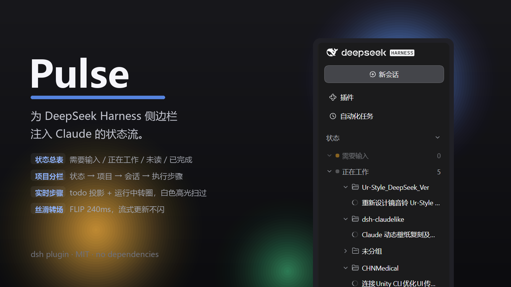
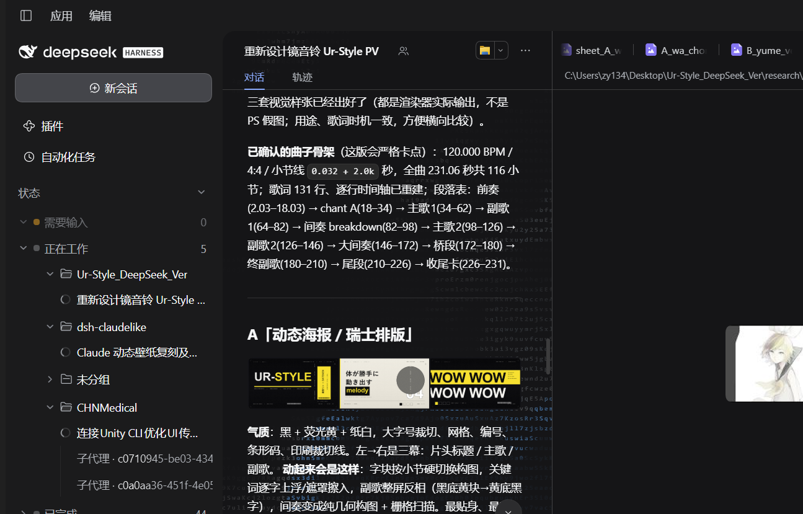
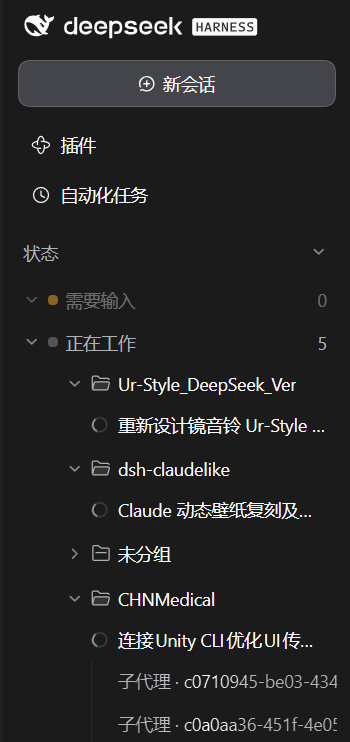

<div align="center">



# Pulse

**给 DeepSeek Harness 侧边栏注入 Claude 的状态流。**

原生工作区树一行不动，状态表叠在它上面：谁在等你、谁在跑、谁刚完成——一眼到底。

> 名字取自「侧边栏的脉搏」：会话状态像心率一样实时起伏，你随时知道系统还在跳。

[](LICENSE)
[](https://github.com/zhangyuzhangyu233/dsh-pulse)
[](#)

</div>

---

## 为什么要它

DSH 的侧边栏擅长回答「我的会话放在哪个项目」，
但它不太回答「**现在**发生了什么」——哪个在等我批准、哪个在跑、哪个刚跑完我还没看。

Claude 的桌面端把这件事做得很好：agent 列表按状态分组、运行中的会话带实时动静、完成的会话留一个未读标记。
Pulse 把**这套状态语言**移植到 DSH：不是替换原生列表，而是在原生列表上方加一层实时状态表，让「项目结构」和「任务状态」同时可见。



## v0.5.0：清空动效 + 手风琴折叠

- **清空已完成更有节奏**：整组清空时逐行向右滑出并淡出，**自下而上**进行（项目内从最后一个会话开始，项目行最后消失）；单项目清空则先会话、后项目；
- **按住右滑删除**：在「已完成」通知行上按住向右拖动，超过 `max(120px, 45% 宽度)` 即滑出删除，未超过则平滑回弹；
- **状态切换回到 Claude 式平滑平移**：会话行用 FLIP 从旧分组位置滑到新分组位置，没有右滑、没有重影；只有真正新出现的会话才有轻微淡入；
- **折叠/展开改为手风琴**：分组、项目、折叠摘要统一使用和原生工作区项目一致的高度 + 透明度动画（展开 200ms / 折叠 170ms），并彻底移除了折叠时消失行的残留 ghost 动画。

## v0.4.1：子智能体会话归入「子智能体」

DSH 里由子智能体（subagent）创建的会话没有工作区归属，之前在状态表的项目分组里会落到「未分组」。现在按会话的 `origin === 'subagent'` 识别，单独归入 **「子智能体」** 分组（英文 `Sub-agents`），并排在其他项目分组之后；折叠、会话行、运行步骤等行为不变。

## 最新更新 · v0.4.0：折叠摘要 + 完整通知中心

- **折叠态 = Claude 式摘要**：只显示有内容的行（需要输入 / 待审查 / 正在工作 / 未读），0 计数自动隐藏；标题右侧显示未读总数；
- **摘要行可就地展开**：点任意摘要行，直接在该行下方展开项目 → 会话 → 运行步骤，再点收起；展开状态持久化；三角随展开/收起旋转；
- **展开态 = 完整通知中心**：四组常驻并全部展开；已完成保留清空 / 单条删除；折叠态标题旁的铃铛图标可直接打开通知中心；
- **未读语义统一**：已完成里未读项排最前、带蓝点加粗；「未读 N」在两个状态里是同一批会话；
- **两种清理动作分开**：「全部标为已读」只清未读标记、保留历史；「清空已完成」只清已读历史，未读默认保留。

## v0.3.0：状态表变成通知中心

- **已完成 = 通知中心**：悬停「已完成」分组行会出现垃圾桶按钮，一键清空全部已完成通知；每条已完成会话悬停时出现 ×，可单独删除这条通知；清空/删除只作用于通知层，**不会删除或归档真实 DSH 会话**，并用 localStorage 持久化；
- **四种状态常驻 + 默认展开**：需要输入 / 待审查 / 正在工作 / 已完成 不再因为计数为 0 而隐藏，首次加载即全部展开；
- **悬停图标对齐原生工作区**：分组行的圆点在悬停时变成原生同款实心三角（展开时旋转为倒三角）；项目行的文件夹图标同样在悬停时切换为三角；
- **列对齐重做**：图标居中于原生文件夹图标列，分组文字与工作区项目标题同列，子项列表从分组标题首字下方开始（文件夹 30px / 标题 52px）；
- 清空通知后状态面板保持显示（计数归 0），不会整块消失。

## 它能做什么

### 🧭 状态总表：叠在「工作区」上方，原生树不动

```
状态                          ● 3  🔔  ⌄     ← 折叠态：Claude 式摘要
  ▸ ● 需要输入                     2
  ▾ ● 正在工作                     1
      📁 dsh-coderipple
         Claude 动态壁纸复刻…  ◌ 实时步骤
  ▸ ● 未读                         3
────────────────────────────────────
工作区                                ← 原生列表，完全保留
  ▸ dsh-coderipper
  ▸ ...
```

- 状态分组、展开/折叠、折叠摘要都按 Claude 的语义组织；
- 原生工作区分组、搜索、拖拽、置顶、归档、右键菜单**一行没改**；
- 折叠总表时摘要行保留实时数字（正在工作 / 需要输入 / 未读），空分组自动隐藏箭头。

### 🗂 状态 → 项目 → 会话 → 执行步骤

展开任意状态，里面先按**项目选项卡**分栏（沿用原生 folder 图标与行规格），再是会话：



- 运行中的会话前面是**和原生列表一模一样的转圈图标**（同一套 SVG 几何 + 1.5s 呼吸节奏）；
- 会话下方显示**当前执行步骤**：来自 DSH 的 `todo` 投影里 `in_progress` 的条目；没写 todo 时回退到运行中的**子代理名称**，绝不编造；
- 步骤文字带**白色高光从左往右扫过**，字号/行距与会话行一致（14px / 20px / 32px 行高）；
- 点会话直接打开，点项目行收起该项目。

### 🔔 两态设计：折叠摘要 ⇄ 展开通知中心

**折叠态（默认紧凑视图）**：Claude 式摘要，只列有内容的分类，标题右侧是未读总数和通知中心入口（铃铛）。每行可以就地展开，查看该分类下的项目、会话与运行步骤。

**展开态（通知中心）**：四组常驻并全部展开，已完成分组按未读优先排序：

- 未读项带蓝点加粗，排在前面；打开会话后 DSH 原生清掉未读，自动移入历史；
- 悬停「已完成」分组行：**✓ 全部标为已读**（保留历史）与 **🗑 清空已完成**（只清已读历史，未读保留）；
- 悬停单条已完成会话：行尾 × 单独删除这条通知；
- 计数实时跟随，状态写入 localStorage；只影响 Pulse 的通知层，不删除或归档真实 DSH 会话。

### 🎞 丝滑的状态切换

逆向自 Claude timeline 动画的运动参数，做了一套 FLIP 转场：

| 动作 | 动效 |
|---|---|
| 会话跨状态组移动 | 240ms `cubic-bezier(.3,.7,.4,1)` 平滑滑行 |
| 新出现 | 淡入 + 上移 6px，同曲线 |
| 消失 | 180ms ease-out 淡出 + 上浮 4px（幽灵行） |
| 流式更新 | rAF 合帧 + 内容签名去重，数据没变不重建 DOM，动画不被打断 |

系统「减少动态效果」时全部降级为静态。

### 🎛 可控、可演示

- 设置 → 通用里两个开关：**Claude 状态表**、**模拟状态数据（演示）**；
- 演示模式用脚本数据循环播放全部状态、项目分栏、执行步骤，不需要真的跑任务；
- 中英双语、明暗主题 token 自适应、侧栏折叠 rail 时自动隐藏。

## 安装

> 需要 DeepSeek Harness，且 Web UI 中安装过本地插件。

**方式 A（推荐）**：在 DSH 的「插件」面板里从**本地目录**安装本仓库根目录，
或调用 Harness 的 `plugin_manager` 工具：

```text
install_bundle  target = <本仓库绝对路径>
```

**方式 B（手工登记）**：

1. 把本仓库克隆到任意位置；
2. 在 profile 的 `node_modules` 下建软链指向仓库根目录（例如 `<profile>/node_modules/dsh-pulse`）；
3. 在 profile 的 `cordis.yml` 插件列表里加一条：

```yaml
- id: dsh-pulse
  name: dsh-pulse
```

4. 重启 DSH，在插件面板确认 `Pulse · 状态栏脉搏` 已启用。

安装后：设置 → 通用 → 打开「Claude 状态表」。想先看看效果，再打开「模拟状态数据（演示）」。

## 设计来源（逆向笔记）

- **Claude 桌面端**（`Claude_2.42304`，`ion-dist` bundle）：
  - 侧边栏行状态只有四种：`blocked / review / working / unread`，文案 `Needs input / Ready for review / Working / Unread`；
  - 行状态色：warning 琥珀 / accent 蓝 / muted 灰；
  - 动画：`timeline-status-rise`（240ms `cubic-bezier(.3,.7,.4,1)`）、`timeline-status-fall`（180ms ease-out）、展开 200ms `cubic-bezier(.19,1,.22,1)`。
- **DSH 原生 UI**：行高 32px、标题 14px/20px、行间距 2px、section header 36px、`StateDot ongoing` 转圈几何，全部按原生 CSS 实测值对齐。
- 本项目**没有包含、复制或分发任何 Anthropic / DeepSeek 的代码或资源**；视觉与交互为独立重实现，与 Anthropic 无关联、未获其背书。

## 目录结构

| 路径 | 内容 |
|---|---|
| `package.json` / `client.js` / `index.js` | Pulse 插件本体（零依赖） |
| `locale/` | 中文 / English 界面文案 |
| `cordis.patch.yml` | Cordis 插件登记 |
| `docs/` | 宣传横幅与效果截图 |

## 姊妹项目

动态背景（代码涟漪）是独立项目：[**dsh-coderipple**](https://github.com/zhangyuzhangyu233/dsh-coderipple)。

## 已知限制与路线图

- `待审查（Ready for review）` 分组已预留：DSH 当前没有对应信号时计数为 0，但状态行会保留显示；
- 已完成通知的「清空 / 删除」只作用于 Pulse 的通知层，不会删除、归档或修改真实会话；「全部标为已读」是 Pulse 的本地已读标记，不改动 DSH 的 `completionUnread`；
- 「未读」的真实来源是 DSH 的 `completionUnread`（内存态），DSH 重启后未读会重置；
- 执行步骤依赖会话的 `todo` 投影，未写清单的长任务只显示转圈（+ 子代理名兜底）；
- 路线图：hover 卡片（最近活动/工作区）、右键菜单扩展（移动到工作区/分叉）、状态片段筛选。

## License

[MIT](LICENSE)。

---

**English** — Pulse is a Claude-inspired status layer for the DeepSeek Harness sidebar: a live state table (Needs input / Working / Unread / Completed) stacked above the untouched native workspace tree, expandable down to project tabs, sessions and their current run steps, with native-matching spinners, project folder icons, and FLIP state transitions. Collapsed, it shows a Claude-style digest whose rows expand in place to projects, sessions and live steps; expanded, it becomes a full notification center (unread-first ordering, mark-all-read, clear history, per-item dismiss), persisted locally without touching the real sessions. Zero dependencies, MIT licensed. Visual language and motion parameters are reverse-engineered for parity; no Anthropic or DeepSeek code/assets are included, and there is no affiliation.
